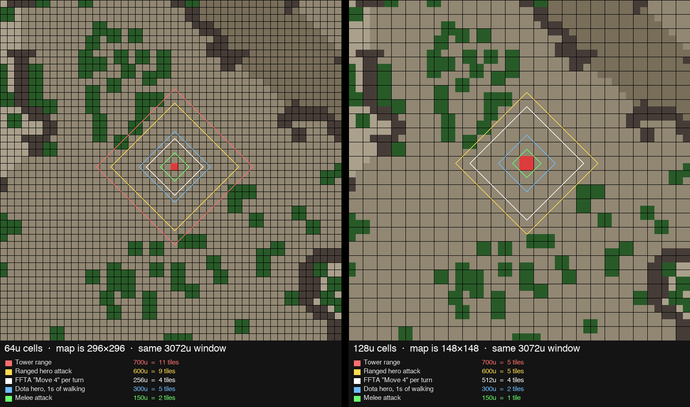

# dota-tactics — design

Final Fantasy Tactics Advance (FFTA / FFTA2) rules on the real Dota 2 map, with Dota's lanes,
creeps, structures and win condition. One hero per player, real-time with an ATB gauge.

This is the living design doc. Decisions are marked **decided**; everything else is a proposal.
Numbers are v0 and expected to change once the prototype is playable.

Related packages: [`dota-cartographer`](../dota-cartographer) (map extraction),
[`dota-tactics-grid`](../dota-tactics-grid) (3D board viewer),
[`threlte-tactics`](../threlte-tactics) (FFT-style engine port).

---

## 1. Pillars

- **It is the Dota map.** Every 64-unit tile, tree, cliff and structure comes from `dota_map.json`.
  Nothing is hand-placed.
- **It plays like FFTA.** Races × jobs, abilities learned from equipment, facing, height, charge-time
  spells, reaction/support abilities, MP from zero.
- **It is won like Dota.** Lanes, 30-second waves, towers, barracks, the Ancient, neutrals, Roshan,
  day/night, respawn timers, buyback.
- **Nobody waits.** Real-time with an ATB gauge. Turn structure survives per unit, not per table.

## 2. Decided

| Area          | Decision                                                                                    |
| ------------- | ------------------------------------------------------------------------------------------- |
| Players       | One hero per player. 5v5 is the target; single-player and 1v1 first.                        |
| Match length  | ~30 minutes.                                                                                |
| Map           | Full Dota map, 64u cells, 296×296. FFTA ranges scaled ~2.5× to fit.                         |
| Clock         | Real-time. Each unit has an ATB gauge (§3).                                                 |
| Movement      | Continuous, click-to-move, Dota-ish speed. **The gauge does not charge while walking.**     |
| Rules base    | FFTA / FFTA2. Facing as evasion, equipment teaches abilities, A2 MP regen.                  |
| Grid          | 4-way movement, no diagonals (for now). Facing is 4-way. (§4)                               |
| Ranges        | FFTA shapes: ranges are Manhattan diamonds, AoE uses FFTA patterns. (§5)                    |
| Orders        | An attack order repeats; abilities are always explicit; no auto-acquire when idle. (§3)     |
| Controls      | Dota 2 default layout. (§11)                                                                |
| Jobs          | Race + job fixed at draft. No mid-match job changes.                                        |
| Laws / Judges | **Not** included. Judge Points as a team resource may stay (§9).                            |
| Creeps        | Full units, same rules as heroes, no abilities. Denies in. (§6)                             |
| Vision        | Dota fog of war, 360°, Dota radii. Trees and height block line of sight. Team-shared. (§10) |
| Structures    | Dota rules, FF names: Crystal, Sentinels, Camps, Clan Hall. Glyph = Wall, 15s. (§9)         |
| Win           | Destroy the enemy Crystal (Ancient).                                                        |

## 3. Clock: ATB

Every unit has a gauge 0–100 that fills at `speed` points per second **while the unit is standing
still**. At 100 the unit may act. Acting resets the gauge to 0.

- Baseline `speed` 20 → one action per 5s. Ninja/Assassin ~28 (3.6s), Defender ~15 (6.7s).
- A full gauge holds; nothing is lost by thinking except time. No overflow / banked turns.
- Walking charges at 0–25% rate (tune in prototype; start at 0).
- Non-player units (creeps, towers, neutrals) act the instant they fill.
- The sim runs at 20 ticks/s. Within a tick, units act in id order (spawn order): units that
  fill on the same tick act in that order. Deterministic for netcode.

Why "no charge while walking": it reproduces FFT's move-or-wait trade-off continuously.
Every tile stepped is time not charging. The chaser arrives with an empty gauge; the person who
stops first acts first. Melee must move to reach, ranged may stand and charge — Dota's
melee/ranged gap from one rule. Kiting is step-stop-act.

Risk to watch: fights degenerate into statues. Counters already in the rules: charge-time AoE
aimed at tiles punishes standing still; facing punishes it from behind.

### Actions

One action = attack, ability, item, or a free re-face. There is no "move" action.

**Orders** (decided). An attack order repeats, as in Dota: walk into reach, stop, charge, hit,
charge, hit, until the target dies or the order changes. Abilities and items are always explicit.
An idle unit never picks its own target: auto-acquiring would spend the full gauge a player was
holding for a spell. (Creeps and towers do acquire; they have no spells to hold for.)

- **Instant abilities** resolve on use.
- **Charge-time abilities** (FFTA spells) enter the world with their own timer and a visible bar
  over the caster, resolving on target tiles when it fills. Stun interrupts. This is Dota
  channeling and FFTA charging at once. 2–6s.
- **Reaction abilities** (Counter, Reflex, Auto-Potion…) trigger on being hit, no gauge cost.

### Facing

FFTA rule, 4-way: front = full evasion, sides = half, back = none. Damage is unaffected.
Facing auto-sets toward the last target or walk direction; re-facing is free at the end of an
action. Magic ignores facing (except by reaction abilities), as in FFTA.

Emergent: standing inside an enemy creep wave means you are flanked. Pulling creep aggro onto an
enemy hero turns off their evasion.

### MP

FFTA2 rule: start at 0, +10 per **action taken** (not per second, or standing still double-dips).
Mages scale with fight length: early skirmishes are melee, by the fourth action the Black Mage has
Firaga. Ethers for burst mana.

## 4. Scale

Gameplay cell = render cell = 64 Dota units. FFTA's numbers are treated as _ratios_
(melee 1 : bow 4 : tower 6 : move 4) and scaled ~2.5×.



Measured on the extracted map (straight line; real paths ~20–30% longer):

| Distance                    |   Units | Tiles | Hero @300u/s |
| --------------------------- | ------: | ----: | -----------: |
| Fountain → own T1 mid       |   8,095 |   126 |          27s |
| Fountain → own T1 safe lane |  12,329 |   193 |          41s |
| T1 → enemy T1, mid          |   2,919 |    46 |          10s |
| T1 → enemy T1, side lane    |  ~4,350 |   ~68 |         ~15s |
| Fountain → map centre       |  10,185 |   159 |          34s |
| Fountain → enemy Ancient    |  17,638 |   276 |          59s |
| T1 top → T1 bot (rotation)  |  13,898 |   217 |          46s |
| Fountain → Roshan           |  11,111 |   174 |          37s |
| Full creep lane path, mid   |  13,500 |   211 |     42s @325 |
| Full creep lane path, side  | ~21,000 |  ~330 |    ~65s @325 |

### 4-way movement

Movement is 4-way, no diagonals (decided, for now). Routes along the grid axes barely change;
diagonal routes get up to √2 longer. Shortest walkable paths from the Radiant fountain at
4.7 tiles/s:

| To            | 8-way | 4-way | Ratio |
| ------------- | ----: | ----: | ----: |
| Own T1 top    |   31s |   32s |  1.06 |
| Own T1 mid    |   26s |   37s |  1.41 |
| Own T1 bot    |   41s |   43s |  1.04 |
| Enemy T1 top  |   46s |   50s |  1.08 |
| Enemy T1 mid  |   36s |   51s |  1.41 |
| Enemy T1 bot  |   51s |   60s |  1.18 |
| Enemy Crystal |   59s |   82s |  1.40 |

Mid runs diagonally, so it stops being the short lane. Accepted for the slice; if mid feels
long, the fixes are a faster walk or letting diagonal steps back in.

Rejected alternatives, for the record:

- **128u gameplay cells.** FFTA numbers fit unchanged, but trees/cliffs lose 64u-wide jukes and
  ramps, ranges quantise badly (tower 700u and attack 600u both round to 5), and heights need
  resampling. Decided against because the exact map is the point.
- **Turn-based movement (FFTA move 4 per turn).** 0.8 tiles/s vs Dota's 4.7. Fountain to safe
  lane = 4 minutes. Dead on arrival at map scale.
- **"March mode"** (real-time out of combat, grid turns in combat). Two movement systems, a
  gameable boundary, and chases become impossible. Superseded by the gauge rule.

## 5. Number sheet, v0

All tiles are 64u. Speeds in gauge points/sec. Every range is **Manhattan** (tile steps, drawn
as a diamond), as in FFTA (decided). With 4-way movement that is exactly the walking distance,
so "in range" and "this many steps away" always agree.

| Thing                         |          Dota units |                 Tiles | Notes                             |
| ----------------------------- | ------------------: | --------------------: | --------------------------------- |
| Melee reach                   |                 150 |                     2 | adjacent + 1, diagonals reachable |
| Ranged attack, base           |                 600 |                     9 | Sniper / Archer +2–3              |
| Tower range                   |                 700 |                    11 |                                   |
| Tower aggro / backdoor radius |                 900 |                    14 |                                   |
| Creep aggro                   |                 500 |                     8 |                                   |
| Spell range                   |             600–900 |                  9–14 | Fire 10, Cure 8, Haste 8          |
| AoE radius                    |             250–400 |                   4–6 | Firaga r4, Quake r6               |
| XP share radius               |               1,300 |                    20 |                                   |
| Hero walk, Move 3 / 4 / 5     | 225 / 300 / 385 u/s | 3.5 / 4.7 / 6 tiles/s |                                   |
| Creep walk                    |             325 u/s |             5 tiles/s |                                   |
| Gauge fill, speed 20          |                   — |                    5s |                                   |
| Charge-time spells            |                   — |                  2–6s |                                   |
| Creep wave                    |           every 30s |                     — |                                   |
| Respawn                       |      10 + 3×level s |                     — | buyback for gold                  |
| Day / night                   |               5 min |                     — |                                   |

## 6. Creeps

A creep is a full unit: tile, HP, gauge, facing, team. ~90 lane creeps and ~80 neutrals alive
at once is fine. Pathing is a flow field per lane, precomputed from the cartographer waypoints
over the walkable layer.

### AI

1. Walk the lane flow field.
2. Enemy within 8 tiles → stop, pick target. Dota priority: enemy hero attacking a friendly hero
   > nearest creep > nearest hero > tower.
3. Charge (same rule as heroes: only while standing, so first attack lands ~3s after contact).
   At full, attack. Re-evaluate.
4. No enemy in 8 tiles → resume walking. Something standing in the way (a hero body-blocking, a
   creep that stopped) is walked round: towards the nearest free tile further down the lane.

Hitting an enemy hero near creeps pulls their aggro — Dota's main laning tool, kept exactly.

### Waves

- Every 30s per lane: 3 melee, 1 ranged. Siege every 5th wave (every 2nd late).
- Stat growth every 7.5 min, as Dota.
- Barracks down → super creeps in that lane; all six → megas.
- Waves meet in the river at ~0:35 mid, ~0:55 side lanes in Dota. With 4-way movement mid is
  ~40% longer (§4); measure it in the headless lane sim before tuning.
- Tuning target: equal waves with no heroes resolve in ~30s, so the next wave arrives into a
  finishing fight and lane equilibrium works. Creep attack cadence ~3s.
- Creeps walk a per-lane flow field: cheapest along the lane's centre line, routed round
  structures' footprints, so waves keep to the road; off it (chasing), they head back.

v0 creep stats (`src/lib/content/units.ts`):

| Creep  |  HP | ATK | DEF | Speed | Reach | Note                   |
| ------ | --: | --: | --: | ----: | ----: | ---------------------- |
| Melee  | 550 |  80 |   4 |    33 |     2 |                        |
| Ranged | 300 |  70 |   0 |    33 |     8 |                        |
| Siege  | 900 | 100 |   0 |    15 |    10 | ×2.5 against buildings |

Measured (`pnpm lane-sim`, mid lane, T1s only, no heroes, 12 seeds × 30 min):

- First contact at **0:29**, 58% of the way from the Radiant T1 to the Dire T1. 4-way
  movement didn't make mid late after all: the spawners are closer than Dota's timing implied.
- Wave fights last a median **30 s** (from a wave's first blow to its last creep's death). On
  target.
- The front swings between the T1s over ~4–5 minutes, as unattended Dota lanes do.
- Creeps alone took a T1 in 2 of 12 seeds, earliest at 26:18 (siege waves add up).

### Identity

Creeps are FFTA monster families. Radiant: Sprites (ranged), Goblins (melee), Antlion siege.
Dire: Zombies / Ghosts (melee), Red Caps (ranged), Flan siege. Dire creeps are undead: Holy and
Cure damage them. Megas are the "Dark" variant of each family. Hunter's monster-family bonuses
apply.

**No creep abilities** (decided). Blue Mage learns from neutrals and Roshan only — the jungle is
the Blue Mage lane.

### Economy

- **Gold**: last hit only. Dota values (melee ~36, ranged ~45, siege ~70).
- **XP**: shared within 20 tiles of a creep death. Levels drive stats.
- **AP**: not from creeps. See §8.
- **Deny** (decided): attack own creep under 50%. Enemy gets reduced XP, no gold. Costs a full
  action — a real sacrifice.

Last-hit reading: creep HP falls on _other_ creeps' gauges; the skill is "will it still be alive
when my gauge fills."

### Collision

FFTA rule: walk through allies, never stop on them; enemies block. The enemy wave is a wall a
melee hero must go around (lanes are 8–15 tiles wide). Steps cost gauge, so going around is a
real cost.

Passing is for heroes. Creeps block each other and heroes (waves keep their shape) and walk
round what stands in the lane, so a hero can body-block its own creeps, as in Dota. One hero
passes through a tile at a time; structures' footprints block everyone.

### Neutrals

28 camps from the map data, each an FFTA monster family (Wolves, Bombs, Lamia, Malboro for
ancients…). Same AI, leashed to spawn. Respawn each minute if the camp area is empty, so
stacking works as in Dota. Hooks: Beastmaster / Morpher dominate (Chen), Blue Mage learns,
Hunter bonuses. Roshan is a boss family; drops an Angel Ring (Auto-Life). Tormentor = a Bomb that reflects.

## 7. Races × jobs = the hero pool

Race-locked jobs give a draft roster for free. "Pick a hero" = pick race + job.

| Race      | Dota shape             | Jobs of note                                                                                  |
| --------- | ---------------------- | --------------------------------------------------------------------------------------------- |
| Bangaa    | Strength cores         | Warrior, Defender, Dragoon, Gladiator, Templar (Omniknight)                                   |
| Viera     | Agility carries, burst | Assassin (Riki), Sniper, Red Mage, Summoner (scion ults)                                      |
| Nu Mou    | Intelligence           | Black / Time Mage, Sage, Alchemist (support items), Beastmaster / Morpher (Chen, Enchantress) |
| Moogle    | Utility, odd           | Gunner, Gadgeteer (Chaos Knight), Juggler, Animist, Mog Knight, Thief (gold-steal ganker)     |
| Hume      | Flex                   | Soldier, Paladin, Fighter, Hunter (monster-family damage), Blue Mage (learns from neutrals)   |
| Seeq (A2) | Greedy brawlers        | Viking, Berserker, Ranger (traps = wards / mines)                                             |
| Gria (A2) | Fliers                 | Raptor, Ravager, Geomancer (terrain, trees)                                                   |

Clan titles / privileges → per-match talent tree at levels 10/15/20/25.

## 8. Equipment, abilities, AP

FFTA's core loop: equip gear that teaches an ability, earn AP, master it, keep it. This **is**
Dota's item system with a learning curve. **The shop sells FF gear only** (decided); Dota's
items do not exist, which keeps the game from being Dota with a skin.

- Gold does double duty: stats now, abilities permanently. Early items are "what do I want
  mastered by minute 15."
- **AP accrues per action you take** while wearing the item (+ bonus on kill / assist). Not
  from farm, so a support that acts constantly masters items as fast as a farmed carry.
- **Slots**: FFTA's five — weapon, offhand, head, body, accessory — plus a consumables bag.
  Weapons teach action abilities; armor and helms teach reaction / support; accessories are
  passives. A build is "which five pieces, in what order, to master what."
- **Consumables**: everyone may use them as an action (Dota rule). Alchemist uses them at range
  and at double effect.
- **Shop tiers** unlock by match time (0 / 10 / 20 min). Bought at the fountain; delivered by
  **Dispatch** (courier) if you're in the field.
- **Bazaar** (A2): neutrals drop loot; combinations unlock gear the shop doesn't sell. This
  replaces Dota's neutral items — you jungle for ingredients.
- Curate ~60 pieces for the real game, chosen by what they teach. Prototype needs ~6.

### Dota item roles → FF answers

| Dota                  | Answer                                                                                                         |
| --------------------- | -------------------------------------------------------------------------------------------------------------- |
| Boots                 | Spiked / Feather / Dash Boots, Move +1 / +2. Accessory.                                                        |
| Blink Dagger          | **A job, not an item.** Dragoon Jump, Gria flight, Time Mage, Assassin. Mobility is drafted.                   |
| BKB                   | Ribbon / Star Armlet — status immunity, passive.                                                               |
| Force Staff, Eul's    | Time Magic.                                                                                                    |
| Aghanim's             | None. Mastery is the upgrade.                                                                                  |
| Stat items            | Gear is stat items.                                                                                            |
| Tango, Salve, Clarity | Potion, Hi-Potion, Ether.                                                                                      |
| Bottle / runes        | Lotus pools and rune spots stay as map features.                                                               |
| **TP scroll**         | **Warp Stone.** Consumable, 3s channel to a friendly structure, cooldown. Prototype: everyone starts with one. |
| Wards, Smoke, Dust    | See §10.                                                                                                       |
| Aegis                 | Roshan drops an **Angel Ring** (Auto-Life). Lost on death.                                                     |
| Buyback               | **Phoenix Down**, priced like buyback. Alchemist can throw one on an ally's corpse.                            |
| Courier               | Dispatch.                                                                                                      |
| Neutral items         | Bazaar.                                                                                                        |

Open: the curated item list, what teaches what, AP costs.

## 9. Structures

FFTA has none, so they take FF names: Ancient → **Crystal**, towers → **Sentinels**,
barracks → **Camps**, fountain → **Clan Hall**. The Dota names are used below for clarity only.

### Sentinels (towers)

Units with HP and a gauge; never move, so they're always charging. Speed 25 → one hit every 4s.

| Tier    | Damage vs heroes | Note                                                                 |
| ------- | ---------------: | -------------------------------------------------------------------- |
| T1      |              300 | ≈30% of a level-1 hero (285 on the Warrior); a dive buys ~2 actions. |
| T2      |              340 |                                                                      |
| T3 / T4 |              400 |                                                                      |

- Range 11, aggro radius 14, vision 30 / 12, true sight 11.
- Hit chance 100%; evasion does not apply. Attackers below the tower still take the 25% uphill
  miss, so diving high ground is punished.
- DEF 130: creeps chip (a melee creep does 15 a hit), heroes dent (Dota's rule).
- **450 before DEF against creeps** (×1.5 on the T1's 300): 2 hits a melee or siege creep, 1 a
  ranged. With 180 against creeps a T1 needed a minute to clear a wave that comes every 30 s,
  and creeps alone took a T1 in 6 of 8 seeds within 15 minutes (earliest 8:29). At 450, creeps
  alone take a T1 in 2 of 12 seeds over 30 minutes (earliest 26:18). Against heroes it hits for
  its plain ATK. (×1.6 on 280 would be 448 before DEF: a 900 HP siege creep would survive two
  hits.)
- Footprint 3×3 tiles; reach and aggro are measured to its nearest tile.
- **Aggro** (Dota's): target the closest enemy, except an enemy hero who attacks an allied hero in
  range becomes the target immediately. Aggro drops if you attack your own creep — **which costs
  an action here**, so dropping tower aggro is a real trade.
- **Backdoor**: T1 has no protection. T2+ regenerate fast and take −25% damage when no enemy
  creep is within 14 tiles.
- **Death**: 125 gold to the team plus a last-hit bonus. Deny your own tower under 10%.

### Camps (barracks), Crystal (Ancient)

- T3 down → that lane's Camps are vulnerable. A Camp down → super creeps in that lane; all six →
  megas.
- T4s are vulnerable once any T3 is down. The Crystal is vulnerable once both T4s are down.
  Destroying it wins.

### Glyph

**Wall** (decided): every structure and lane creep is invulnerable for 15s (~3 actions).
5-minute cooldown, refreshed when a T1 falls. Dota's 6s is less than one action here.

### Other

- **Clan Hall** (fountain): huge damage, true sight, full regen area. Untouchable.
- **Outposts** (both in the map data): capturable by a 6s channel once the nearby T2 is down.
  Grant vision and are Warp Stone targets.
- **Day / night** every 5 min; affects vision (§10).
- **Death**: countdown; Phoenix Down is buyback (§8). Possible: Rubick-style "take an ability
  from the corpse" — not decided.
- **Judge Points** (A2): earned by acting and killing, spent on Combos and Scion summons.
  Proposal: team-shared ult gauge. Roshan grants a large chunk.

## 10. Vision

FFTA has no fog; Dota's is copied nearly exactly, because the map data (height levels, trees)
already contains everything it needs and without it there are no ganks, no reason for day/night,
and nothing for Ninja / Illusionist / Ranger to do.

- **Team-shared.** Anything a friendly unit or structure sees, the team sees.
- **Radius** (tiles, day / night): hero 28 / 12, tower 30 / 12, creep 13 / 12. Night radius is
  smaller than most spell ranges (10–14) on purpose: at night you can be hit by what you can't
  see.
- **360°** (decided). Facing stays a combat stat; a gank from fog already hits your back.
- **Height**: you see your level and below, never up a level except from the ramp.
- **Trees** block line of sight; a unit inside a tree tile sees out. Cut trees regrow after
  5 min. Tree-cutting is job-gated (Geomancer, Viking, Gria).
- **Line of sight** is computed per tile pair over the level and tree layers, not just radius.
- Attacking from fog reveals the attacker briefly.
- Unit-targeted abilities need vision; tile-targeted ones can be aimed into fog. Charge bars are
  visible only while the caster is.
- **Enemy HP and gauges are visible whenever the unit is.** The last-hit and "about to act"
  reads depend on it. Fog is the only thing that hides information.
- Map features already in the data: outposts (vision + Warp Stone target when owned), the ten
  watchers (activate for a vision radius), Roshan's pit.

### Dota vision items → FF answers

| Dota                 | Answer                                                                                                                          |
| -------------------- | ------------------------------------------------------------------------------------------------------------------------------- |
| Observer ward        | **Watcher's Lantern** — consumable, tile-placed, 25-tile vision, 6 min, 2 per team. The one invented item.                      |
| Sentry ward          | **Sentry Lantern** — consumable, true sight in 15 tiles, 6 min. (Decided: consumable, so a draft without detection isn't lost.) |
| True sight abilities | Ranger's Sight trap, Sage's _Sight_.                                                                                            |
| Smoke of Deceit      | **Smoke Bomb** — real FF item. Team-wide Transparent until near enemies.                                                        |
| Dust, Gem            | None.                                                                                                                           |
| Invisibility         | Ninja / Assassin / Illusionist. Transparent status, broken by acting.                                                           |
| Scan                 | The map's watchers.                                                                                                             |

Prototype: slice 1 is fog-free to test the ATB feel in isolation; slice 2 adds fog, a jungle
entrance and a third hero to test ganks.

Netcode: fog means the server must own visibility eventually. Prototype trusts the client.

## 11. Prototype slice

One lane (mid). Two T1 towers. Waves. Two heroes: **Bangaa Warrior** vs **Nu Mou Black Mage**,
mage starts at 0 MP, each with one piece of gear teaching one ability. You pick a side; a
scripted AI plays the other hero (decided). No fog. Win = kill the far tower.

It answers the only two questions that need play to answer:

1. Does one action per ~5s feel tense or laggy?
2. Does "walking stops your gauge" produce kiting, or statues?

Levers if it's laggy: higher base speed, larger walk speed, partial charge while walking.

### Architecture

- **The board comes from [`dota-tactics-grid`](../dota-tactics-grid)**: `MapModel`, terrain,
  water, trees, entity models, picking, lighting and the renderer, imported as a workspace
  package. `dota-tactics` provides the `ViewerState` its components read. If the coupling hurts,
  a shared board package gets extracted later.
- **Ideas, not code, from [`threlte-tactics`](../threlte-tactics)**: the ability pipeline
  (range → area → effect target → hit rate → power → effect), stat modifiers via value-change
  exceptions, status effects with durations (in ticks). Its turn state machine, turn order,
  board and keyboard UI are built for turns and stay behind. The seeded PRNG is lifted as is.
- **The sim is plain TypeScript, not runes classes** (a deliberate break from
  `threlte-tactics`). Fixed 20 ticks/s, integer ticks, a seeded PRNG, units updated in id order:
  deterministic, runs in Node tests, and can move to a worker or server for networking. ~200
  units ticking through Svelte proxies would be slow and couldn't run headless.
- A thin runes `GameState` owns the sim: steps it each frame, turns input into commands, and
  exposes a snapshot for the HUD and scene. The renderer interpolates positions between ticks.

```
src/lib/sim/         world, tick, units, gauge, movement (A* for heroes, a flow field per lane
                     for creeps, tile occupancy), combat (hit / facing / damage), abilities,
                     status, ai (creep, tower, hero), spawner, win
src/lib/content/     jobs, abilities, items, creeps, towers, tuning: the numbers in this doc
src/lib/game/        GameState (runes): loop, input → commands, snapshot
src/lib/components/  HUD, scene (units, range diamonds, AoE preview, charge bars)
scripts/lane-sim.ts  headless: mid lane with no heroes, prints the numbers
```

### Controls

Dota 2 default layout (decided):

| Input                             | Does                                                          |
| --------------------------------- | ------------------------------------------------------------- |
| Right-click ground                | Move                                                          |
| Right-click enemy                 | Attack order (repeats)                                        |
| Right-click own creep under 50%   | Deny                                                          |
| A, then left-click                | Attack-move                                                   |
| S / H                             | Stop / hold                                                   |
| Q W E R D F                       | Abilities; left-click to target, right-click or Esc to cancel |
| Z X C V B N                       | Items (consumables bag)                                       |
| F1, Space                         | Centre on hero; Space held keeps it centred                   |
| Mouse at screen edge, middle-drag | Pan                                                           |
| Wheel                             | Zoom                                                          |
| `[` / `]`                         | Turn the view 90° (FFT style; Dota has no rotation)           |

### Milestones

Each is playable or testable on its own.

1. **Scaffold.** ✅ SvelteKit package with the grid's config; the real map renders through the
   grid's scene; game camera with the Dota controls, following a point.
2. **Creeps and towers, no heroes.** ✅ Mid waves, flow field, aggro, attacks, deaths, the two
   T1s. `pnpm lane-sim` checks §6 headless (results in §6, §9). In the browser: HP and CT bars,
   bolts, lunges, hit flashes; click to select, the clock with speeds 0–8×.
3. **One hero.** ✅ Warrior: click to move, attack orders, the gauge (charges only standing),
   facing, First Aid, Body Slam, gold on last hits, denies, death and respawn. Details below.
4. **Black Mage.** MP from zero, Fire, Blizzard + Chill, Fira with a 2s visible charge,
   Rend Speed + Slow. Facing evasion, uphill miss.
5. **Opponent.** Scripted hero AI: follows its wave, last-hits, trades when ahead, casts when it
   has MP, retreats at low HP. Respawn at the Clan Hall. Win on the enemy T1 mid.
6. **Tuning.** Pause, step, sim speed; a live panel for the §5 numbers. Telemetry for the two
   questions: time walking vs charging, actions per minute, and **how long gauges sit full** —
   if players always act the instant the gauge fills, the cadence is too slow.

### Milestone 3: one hero

The player's Bangaa Warrior (Radiant) in the milestone-2 lane. No enemy hero yet. Built as
planned below, except where "Built differently" says.

**Numbers first.** §13's Warrior and §9's Sentinels (300 / 340 / 400 against heroes, `vsCreeps`
1.5 so creeps still take 450 before DEF) in `content/`. `UnitStats` gains `kind: "hero"`, `mp`
(max) and `bounty`; RES, MATK and Jump come with magic (milestone 4).

**Sim** (`src/lib/sim/`):

- **Heroes.** `content/heroes.ts`: jobs as data (name, stats, ability ids). A `Unit` gets
  `hero: HeroState | null`: order, MP, gold, last hits, denies, respawn tick. The scenario
  lists heroes (team, job); they start at their Clan Hall (the fountain entity's nearest free
  tiles). Walk speed from Move: Move 4 = 300 u/s.
- **Commands.** `world.command(unit, order)` queues; queued commands apply at the start of the
  next `step()`, in issue order, so a replay of (tick, command) pairs reproduces a game (the
  networking hook).
- **Orders.** `idle` · `move` (tile) · `attack` (unit; repeats) · `attackMove` (tile; attacks
  the nearest enemy within 8 on the way, units before structures, then carries on) ·
  `ability` (id, target or none). S and H both stop: an idle hero never auto-acquires (§3), so
  Dota's hold has nothing to add yet. After an ability on an enemy the order becomes `attack`
  on it; after a self ability, the previous order resumes.
- **Queued actions.** An order whose action isn't ready (gauge not full) walks into reach,
  stands, charges, and acts the instant the gauge fills. A full gauge holds while idle: the
  player times last hits by right-clicking when the creep is low.
- **Pathfinding.** A* over the whole map (`PathSearch`, buffers reused per world), Manhattan
  heuristic, step cost 1, replanned every step (cheap for a few heroes). Structures' footprints
  and enemies block; allies are passable but never a goal. A goal tile that's taken becomes
  the nearest free tile to it. Creeps keep the lane field and the local search.
- **Walking through allies** (§6). A second occupancy layer, `passers`: a hero stepping onto an
  ally's tile holds nothing there and marks `passers`; arriving, it releases what it held
  behind it. Every other unit's `canEnter` needs both `occupant` and `passers` empty. A hero
  blocked while passing waits there and claims the tile the moment it's free. Creeps still
  block each other (waves keep their shape).
- **Attacks and abilities.** Hero attack = the creep attack. Abilities are data
  (`content/abilities.ts`: name, MP, reach, target kind, effect) resolved by a switch in the
  sim; the full threlte-tactics pipeline waits until there are enough abilities to need it.
  First Aid: self, heal 25% of max HP. Body Slam: enemy in reach 2, ATK × 1.6, 10% of the
  damage dealt back to the caster (none on a miss). Every action gives +10 MP (capped). Rend
  Speed is listed but disabled until milestone 4.
- **Last hits and denies.** A hero's killing blow on an enemy creep: Dota's bounty (melee 36,
  ranged 45, siege 70) to its gold, +1 last hit. An `attack` order on an own creep is only
  accepted under 50% HP (otherwise it's a `move` to it); killing it is a deny: no gold, +1
  deny. The death event carries `bounty` and `denied`. No XP or levels yet.
- **Creep targeting** (§6): enemy creeps before heroes before structures; the hero-attacks-hero
  rule waits for an enemy hero.
- **Death and respawn.** A dead hero leaves the board (its tiles freed) and returns after
  10 + 3 × level s (13 s at level 1) at its Clan Hall with full HP, 0 MP, empty gauge, idle;
  same id, so units stay in id order.

**View and input:**

- **Pick by screen.** Units are picked by projecting each unit's body centre to the screen,
  nearest within its pick radius (0.45–0.65 tiles, at least 14 px) of the pointer. A click
  ray-casts its own tile, as the grid's picker does: the picker only looks once a frame, and a
  click can come in the same frame as the move before it. Selection moves off the grid picker's
  pin to this; commands always go to the hero, whatever is selected.
- **Dota controls** (§11 table): right-click ground = move, enemy = attack, own creep under 50%
  = deny (else move); Q First Aid, W Rend Speed (disabled), E Body Slam: an enemy-targeted
  ability enters targeting (left-click a unit, right-click or Esc cancels), a self ability is
  ordered at once; A then left-click = attack-move; S / H stop; F1 centres on and selects the
  hero; Space follows the hero.
- **HeroView.** A Bangaa: bigger team-coloured body, head with a snout, a tail, a sword; facing,
  lunge (bigger for Body Slam), hit flash, blob shadow, bars (HP, CT). A green burst on First
  Aid.
- **Overlays.** While targeting: the ability's reach as a diamond of tile highlights around the
  hero. Order feedback: a green tile flash where you moved, a red ring on what you attack.
- **HeroWindow** (bottom centre): name, HP / MP / CT bars, the three abilities with keys and MP
  (greyed when disabled), what's queued ("Body Slam → Zombie"), gold, last hits / denies, and
  the respawn countdown. The selected-unit window stays for anything else.

**Tests** (Node, small text boards): A* round walls; no charge while walking, charges and holds
full when idle; idle never attacks a creep in reach; an attack order walks in, fires the
moment the gauge fills, repeats every 5 s; passes through an allied creep, never through an
enemy, never stops on an ally; last hit pays the bounty; deny refused above 50%, counted below,
no gold; First Aid heals 25% capped; Body Slam damage and recoil; +10 MP per action capped;
respawn after 13 s at the Clan Hall; creeps prefer creeps to the hero; a command log replays
to the same game. Browser: walk the Warrior to lane, last-hit, deny, die to the tower, respawn.

**Done when** you can play the Warrior in mid against the waves: farm, deny, push the Dire T1
down, die under it, respawn and walk back.

**Built differently** from the plan:

- Sentinels are 300 ×1.5, not 280 ×1.6 (§9): the same 450 against creeps.
- Body Slam costs 20 MP (§13). At 0 MP it would beat a plain attack every action; 20 is more
  than an action's 10, so it's banked for the kill.
- Creeps walk round what stands in the lane (§6). A hero idling in the lane stalled its own
  wave behind it: a creep only stepped to cheaper or equal tiles on the lane field.
- A* breaks ties between equally short paths towards the straight line to the goal (so a hero
  crossing open ground walks the diagonal, not an L), and expands at most 12,000 tiles. Each
  open area of ground is labelled, so a click on a cliff or an island walks to the nearest tile
  the hero can reach. A hero that finds no way waits 5 ticks before searching again.
- Last hits and denies pop up over the creep, Dota's "+36" and "!".
- The controls window moved to the top left, out of the hero window's way.

**Measured.** Fountain to own T1 mid: 38.3 s (§4 estimated 37 s). Hero path searches cost about
0.06 ms a tick. 60 fps at retina with AO on, at the fountain and in the mid fight (the machine
unloaded; milestone 2 measured 36 under load). Nobody has played it yet: the two §11 questions
are still open. One for the playtest: an attack-move that reaches its tile ends, and the idle
hero then stands by the fight without joining it (idle heroes never pick targets, §3).

Rendering moving units on the grid's board: units cast no real shadows (the board's shadow map
is static; they get blob shadows), and `<Renderer dynamic>` refreshes the AO every frame. At
gameplay zoom AO's radius spans many pixels, so the game renders it at a quarter resolution
with 8 samples, and caps the pixel ratio at 1.5. That took a base M2 (under load) from 16 to
36 fps at retina; without AO it holds 60.

## 12. Combat resolution, v0

Kept deliberately simple; the prototype is for feel, not balance.

- **Hit chance** = 95 − evasion. Evasion is full from the front, half from the sides, zero from
  behind. Target one or more height levels above the attacker: −25% to physical attacks (Dota's
  uphill miss). Magic always hits unless a reaction ability says otherwise.
- **Physical damage** = ATK − DEF/2, minimum 10% of ATK.
- **Magic damage** = spell power × MATK/50 − RES/2, minimum 10%.
- **Height**: no damage bonus (FFTA). `Jump` is the number of height levels a unit can step up in
  one tile. Proposal: Jump ≥ 3 (Dragoon) or flight (Gria) can cross one-level cliffs the
  walkable layer marks impassable — a mobility tool Dota reserves for Blink.
- **Status**: FFTA set. Slow / Haste modify gauge fill. Stop freezes it. Stun resets it to 0 and
  interrupts a charge. Chill (new, Dota-ism) reduces walk speed.
- **Charge-time spells**: FFTA spells are instant; FFT's are charged. We use a hybrid: tier 1
  instant, tier 2 charged 2s, tier 3 charged 4s. Charged spells are aimed at tiles, visible,
  interruptible. This is where Dota's channel/dodge play comes from.
- **Walking pauses the gauge, it does not reset it.** A 1-tile sidestep costs 0.2s; a 10-tile
  reposition costs ~2s, i.e. 40% of a turn. Tempo cost is proportional to distance.

## 13. Starter kits, v0

Both kits assume level 1 and no items beyond starting gear.

**Heroes hit big and act rarely** (decided after milestone 2). A hero's hit is ~2–3× a creep's,
so one hero action is worth ~2 creep actions, and the last-hit window is "under ~180 HP": a
couple of creep hits wide, readable from the HP bar. Hero HP scales so a hero duel still takes
~6 trades. (Before this, the Warrior's 58 a hit was weaker than a creep's 80: 50 s to kill a
creep alone, and last hits a coin flip.)

Each job starts with **two mastered abilities** (the draft equivalent of clan history) plus
**one piece of gear teaching a third**. This is a prototype convenience; in the real game the
innate count is a balance knob per job.

### Bangaa Warrior

| Stat    |         Value | Note                                                    |
| ------- | ------------: | ------------------------------------------------------- |
| HP      |           900 | a wave alone kills in ~12 s; another Warrior in ~6 hits |
| MP      | 0, +10/action | max 40                                                  |
| ATK     |           180 | includes Shortsword; 178 on a melee creep               |
| MATK    |            20 |                                                         |
| DEF     |            30 |                                                         |
| RES     |            14 |                                                         |
| Speed   |            20 | one action / 5s                                         |
| Move    |             4 | 4.7 tiles/s                                             |
| Jump    |             2 |                                                         |
| Evasion |            10 |                                                         |
| Reach   |             2 | melee                                                   |

Abilities (Battle Tech):

- **First Aid** (mastered) — self heal 25% HP. 0 MP. The lane salve.
- **Rend Speed** (mastered, A2's Speedbreak) — 10 MP, reach 2, −6 speed on target for 15s. The
  anti-mage tool: the target's gauge fills ~30% slower.
- **Body Slam** (taught by Shortsword, 100 AP) — 20 MP, reach 2, ATK × 1.6 (288 − DEF/2),
  caster takes 10% of damage dealt. The kill button. Its cost is more than an action's 10 MP, so
  it can't be used every action: from empty, two actions bank it, then every other action.

Reaction: none at start. Support: none. Starting gear: Shortsword, Leather Armor.

Plan: close, Rend Speed, trade attacks and First Aid, Body Slam to finish. Walk speed 4.7 beats
the mage's 3.5, so the mage cannot simply run — it needs Chill.

### Nu Mou Black Mage

| Stat    |         Value | Note                                             |
| ------- | ------------: | ------------------------------------------------ |
| HP      |           600 | a Warrior kills it in 4 hits                     |
| MP      | 0, +10/action | max 120                                          |
| ATK     |            60 | Rod; weak on purpose: mages last-hit with spells |
| MATK    |            60 |                                                  |
| DEF     |            16 |                                                  |
| RES     |            32 |                                                  |
| Speed   |            18 | one action / 5.6s                                |
| Move    |             3 | 3.5 tiles/s                                      |
| Jump    |             2 |                                                  |
| Evasion |             5 |                                                  |
| Reach   |             2 | rod bonk                                         |

Abilities (Black Magic):

- **Fire** (mastered) — 8 MP, range 10, instant, hits target tile + radius 1, power 150
  (180 on a creep, 173 on the Warrior: about a Warrior's hit).
- **Blizzard** (mastered) — 8 MP, range 10, instant, single target, power 110, **Chill** −40%
  walk speed for 3s. The kiting tool.
- **Fira** (taught by Firewheel Rod, 150 AP) — 16 MP, range 10, **2s charge**, radius 3,
  power 250.

Reaction: none at start. Support: none. Starting gear: Firewheel Rod, Hempen Robe.

MP curve: action 1 must be a rod attack or item (0 MP). From action 2, Fire or Blizzard every
action. Fira needs two non-casting actions banked. Ether (consumable, +30 MP) shortcuts this.

Plan: Blizzard the approaching Warrior, step back, Fire, step back. The Warrior closes anyway
— the question is how much HP it has when it arrives, and whether Rend Speed lands before Fira.

### What the matchup is testing

- Does the step-stop-act rhythm appear naturally, or do both players just stand and trade?
- Is one Chill enough to make a Move 3 caster kiteable against Move 4 melee, or does the mage
  need Move 4 too?
- Does a 2s charge on Fira feel like a real window to Rend Speed / step out of radius 3?
- Is a 5s action cadence tense at these HP pools (~6 trades to kill), or do fights need to
  be ~30% shorter?

## 14. Open

In rough order of how much they shape the prototype:

1. ~~Starter kits.~~ See §13; validate in play.
2. ~~Towers.~~ See §9.
3. Shop and AP economy (§8).
4. ~~Vision.~~ See §10.
5. Judge Points / Scions / Combos in real time.
6. Networking model (deterministic sim is the goal; fill-order rule in §3 is for this).
7. ~~Hero damage vs creeps.~~ Heroes hit big and act rarely (§13).
